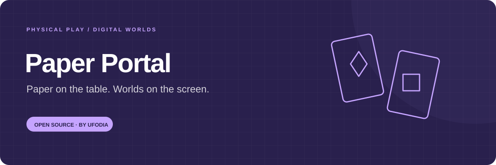
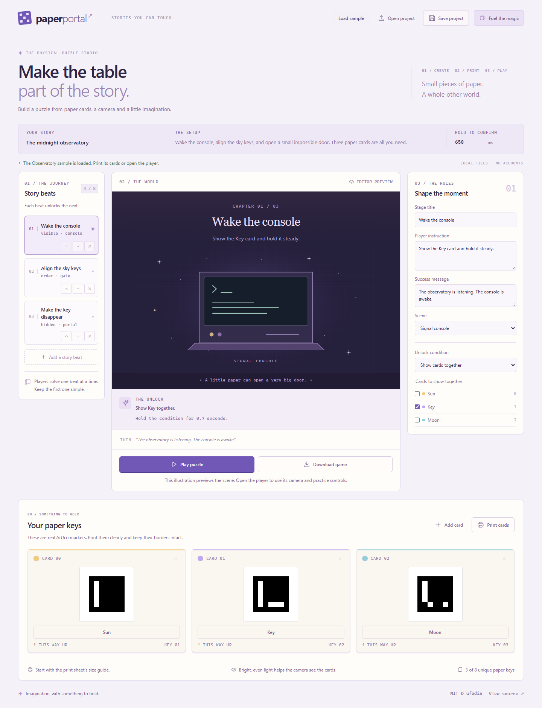
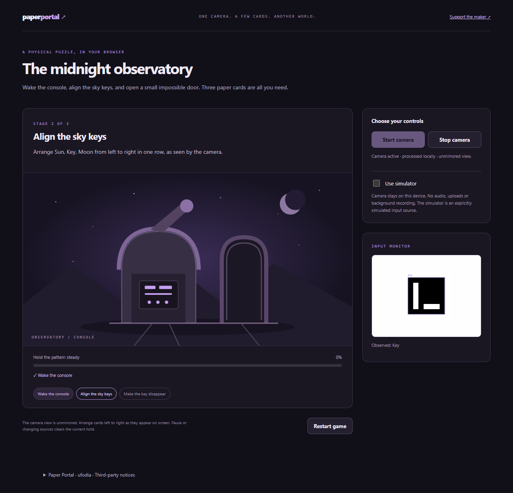

<p align="center">
  
</p>

# Paper Portal

**Make a paper key open a digital door.** Author a sequence of card puzzles, print the markers, and let a webcam turn their presence, order and orientation into changes on screen.

[First game](docs/guide.md) · [Rules](docs/reference.md) · [Architecture](docs/architecture.md) · [Privacy](docs/privacy.md) · [MIT license](LICENSE)

[](https://github.com/ufodia/paper-portal/actions/workflows/checks.yml)
[](https://buymeacoffee.com/ufodia)



## Build a puzzle that reaches off the screen

Put a card on the table to wake a console. Arrange a sequence to unlock a gate. Turn a printed key to open the portal. Paper Portal connects those physical actions to a small authored story without custom electronics, a cloud account or a programming language.

Create **3–8 cards** and **1–8 stages**, then share a playable HTML file with the game and runtime embedded. Your players can use the real camera detector or an explicitly labelled simulator.

| Author                         | Print                               | Play                                               | Share                                          |
| ------------------------------ | ----------------------------------- | -------------------------------------------------- | ---------------------------------------------- |
| Labelled cards and stage rules | Black-and-white ArUco markers on A4 | Presence, hiding, left-to-right order and rotation | Saved project JSON or a standalone HTML player |

## Start the studio

Install **Node.js 24 LTS** and Git:

```sh
git clone https://github.com/ufodia/paper-portal.git
cd paper-portal
npm ci
npm run dev
```

Open the local address printed by Vite. Explore the included project with the simulator, inspect the current stage rule, and try the condition it describes. Then print the cards and test the camera workflow using the [first-game guide](docs/guide.md).

Choose **Play puzzle**, then **Use simulator** in the player. The sample starts by asking you to show **Key**. Keep its checkbox selected until the first beat completes; the guide explains the remaining steps.

The development command builds the standalone-player runtime before starting the studio. You do not need to create generated files by hand. On Windows, use `npm.cmd` if PowerShell blocks `npm.ps1`.

## What you can make in 0.1.0

- A small deck with editable labels and colors.
- Ordered stages using visible, hidden, card-order or rotation conditions.
- Scene changes across the night, console, gate and portal presets.
- A camera-driven game using the local ArUco detector.
- A clearly labelled simulator for authoring and demonstrations.
- A saved/reopened JSON project, printable A4 cards, and a standalone playable HTML export.

The exported player embeds its runtime instead of loading a detector from a CDN. Camera permission still depends on the browser and where you open the file.

## Physical play and simulated play are different checks

The simulator lets you control observations without owning a camera or printing cards. It does not prove that a physical setup will recognize those cards.

Real camera play requires explicit permission and a supported secure context, such as HTTPS or localhost. Lighting, focus, glare, card size and printing affect detection. See [camera setup and troubleshooting](docs/guide.md) and [what the tests cover](docs/testing.md).



_The player image uses synthetic canvas-camera input through the real detector. Physical camera hardware, lighting and printed-card recognition are not verified by this image._

A hidden-card stage cannot complete just because the camera is empty or stopped: its target must first be stably observed during that stage, then disappear while its specified different witness card remains visible. Gaps and ambiguous observations reset pending progress.

## Develop and verify

```sh
npm run verify
npx playwright install --no-shell chromium
npm run test:e2e
```

`verify` runs type checking, unit tests and the complete build, including the embedded player. The generated runtime is intentionally ignored by Git; its source and build script are tracked.

| Documentation                                   | Purpose                                                   |
| ----------------------------------------------- | --------------------------------------------------------- |
| [First-game guide](docs/guide.md)               | Author, simulate, print, use the camera and share a game  |
| [Rule and project reference](docs/reference.md) | Saved data, observations, completion rules and bounds     |
| [Architecture](docs/architecture.md)            | Detector, rule engine, studio and independent player      |
| [Privacy](docs/privacy.md)                      | Camera permission, local processing and exported content  |
| [Testing](docs/testing.md)                      | Source checks, synthetic-marker tests and physical checks |
| [Restore from GitHub](docs/restore.md)          | Rebuild the studio and player from `main`                 |

## Support another doorway

If Paper Portal helps you run a class activity, build an escape puzzle or share an evening's game, you can [buy ufodia a coffee](https://buymeacoffee.com/ufodia). Support is voluntary and helps maintain the detector integration, tests and authoring tools. The same source and features remain available to everyone.

For contributions, start with [CONTRIBUTING.md](CONTRIBUTING.md). Use [SECURITY.md](SECURITY.md) for sensitive findings.

## License and credits

Paper Portal source: [MIT](LICENSE) · Copyright © 2026 **ufodia**.

Marker detection uses [js-aruco2 2.0.0](https://github.com/damianofalcioni/js-aruco2). Its package declares MIT and credits Damiano Falcioni (2020) and Juan Mellado (2011). Upstream authors retain their copyright and additional notices; Paper Portal's license does not replace them. Read [the complete attribution and retained notices](THIRD_PARTY_NOTICES.md).
