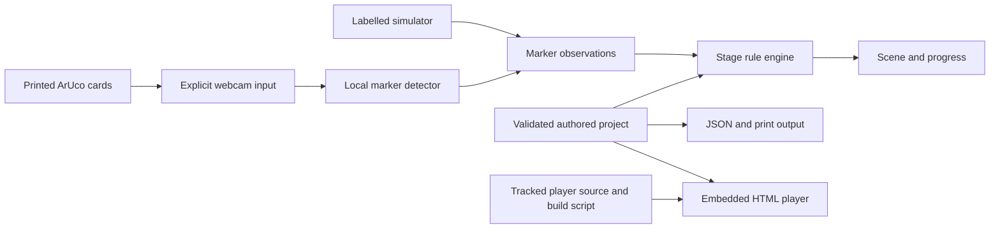

# Architecture and input boundaries

Paper Portal 0.1.0 is a browser-local authoring studio and an independently exported HTML player. Neither requires an application server, user account or cloud processing service.

## Separate the observation from its meaning

The detector interprets camera pixels as marker observations. The rule engine interprets observations according to the current stage. The simulator supplies observations explicitly without claiming to use a camera.

Keeping those boundaries separate lets a test distinguish a marker-recognition failure from a stage-rule failure. Synthetic image tests exercise detector behavior; simulated observations exercise game mechanics. Neither replaces a physical-camera check.

| Source                     | Responsibility                                                         |
| -------------------------- | ---------------------------------------------------------------------- |
| `src/core.ts`              | Project validation, temporal PuzzleEngine, print and game-HTML exports |
| `src/markers.ts`           | ARUCO dictionary generation and real RGBA marker detection             |
| `src/main.ts`              | Studio editing, import/download, print view and embedded-player dialog |
| `src/player.ts`            | Independent game's controls, media lifecycle and scene rendering       |
| `scripts/build-player.mjs` | Bundle the player as a local IIFE in `.generated/player.js`            |
| `scripts/aruco-compat.mjs` | Shared ESM bridge for the pinned upstream legacy module boundary       |

Both studio and standalone player use the same compatibility bridge. It loads the locked, unchanged upstream CV/ArUco algorithms and adapts their legacy `this.AR` / `this.CV` module exports into an ESM virtual module without eval. Vite dependency optimization excludes that package so the bridge is used consistently.

## Rule-state boundary

Progress is temporal: a single matching frame does not establish a stable physical action. The engine maintains the current stage's pending condition and invalidates pending evidence after gaps or ambiguity.

The engine advances at most one stage per fresh frame. Scenes latch when a stage completes. Pause clears pending evidence and target acquisition but preserves solved stages and the latched scene; restart clears the whole sequence. See [the rule reference](reference.md) for timing thresholds and the distinct reset cases.

A hidden-card stage requires prior stable observation of its target during that stage and the authored different witness card to remain visible when the target is absent. Empty or stopped camera input cannot by itself satisfy that rule. Pause, restart and source-switch behavior must preserve this boundary rather than treating a stale observation as new evidence.

## Independent-player build

The tracked player source is compiled by the tracked player build script. Its generated runtime is local build output and is ignored by Git. The studio embeds that runtime with the authored project when it exports a player.

Normal development/build commands regenerate the runtime. A fresh GitHub checkout therefore has the source needed to create an independent player without committing disposable generated code. The export embeds its detector runtime instead of depending on a CDN at play time.

During development the startup script also watches and rebuilds the player runtime, keeping subsequent exports aligned with player-source changes.

The optional `scripts/serve-player.mjs` helper serves one selected exported HTML file at a loopback address. It is a static-file convenience for camera secure-context requirements, not an application backend or game-storage service.

## Upstream attribution

The locked js-aruco2 package supplies marker generation and detection. Its declared MIT license and additional upstream notices remain independent of Paper Portal's original-source license. The repository retains the complete upstream license text and source snapshot; see [THIRD_PARTY_NOTICES.md](../THIRD_PARTY_NOTICES.md). Keep those notices with redistributed player/runtime material.

## Local data and permissions

The browser requests camera access only after an explicit user action. It does not request microphone audio or upload frames. Stopping camera input releases tracks. The browser still enforces its secure-context and permission rules; an exported HTML file cannot grant itself camera permission.

The player processes fresh camera frames at most once per 100 ms, downscaled within 960 × 720 pixels. It uses video-frame metadata where available and a changing media timestamp fallback otherwise. Frozen video is not turned into new rule evidence merely by an animation timer.

Saved JSON and exported HTML contain authored card/stage content. They do not contain a camera recording. The application's source repository does not automatically back up unsaved games.

## Deliberate scope

The initial studio supports a small deck, a bounded stage sequence, four rule types and four scene presets. It does not provide a general scripting language or automatic proof that a printed setup will work under every camera, light level or angle. Test the actual activity environment before relying on physical recognition.
